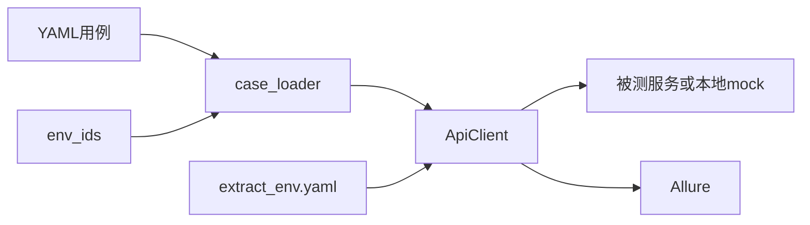

# api-test

用 YAML 描述接口场景，用 pytest 参数化执行。发请求、注入登录态、校验响应都集中在客户端里，测试方法只负责把场景交出去。

YAML-driven API tests on pytest. Cases live in YAML, the client sends the request, injects tokens, checks the response, and attaches failures to Allure.

## 能做什么

- `TEST_ENV` 切换环境。`data/common` 优先于 `data/<env>`
- `${key}` 从 `config/env_ids.yaml` 或调用方替换，整段占位符保留原来的类型
- 登录把 token 写入 `extract_<env>.yaml`，后续请求按 header 里的键名注入；`no_token` 不带 token
- 断言集中处理：HTTP 状态码、业务 `code` / `code_not`、`msg`、`expected_fields`、`expected_data`、递归 `forbidden_fields`（`null` 和空字符串不算泄露）、客户端耗时上限（同一接口首次超时后不再重复计耗时）
- 失败异常只保留校验句，请求和响应挂到 Allure
- 多端配置在 `config/clients.yaml`，不把端写死在代码里

## 架构



## 5 分钟跑通

仓库自带一个本地示例服务，克隆后不用外网。

```bash
python3 -m venv .venv
source .venv/bin/activate
pip install -r requirements.txt
pytest
```

再跑一遍生产配置（示例里只是另一组环境 ID，仍然打到本地服务）：

```bash
TEST_ENV=prod pytest
```

生成 HTML 报告需要本机已安装 [Allure 命令行](https://github.com/allure-framework/allure2)：

```bash
python run.py
allure open report/allure-report
```

## 用例格式

```yaml
- feature: 文章
  story: 列表
  title: 查询文章列表
  request:
    method: GET
    url: /api/posts
    headers:
      token: app_token   # 会话文件里的键名；不登录写 no_token
    params:
      userId: "${user_id}"
    validate:
      status_code: 200
      code: 0
      msg: ""             # 空字符串表示不校验 msg
      expected_fields: ["list", "total"]
      expected_data:
        userId: "${user_id}"
      forbidden_fields: ["createBy", "modifyBy"]
```

对应测试：

```python
import pytest
from framework.case_loader import read_env_testcase
from framework.client import ApiClient

CASES = read_env_testcase("posts.yaml")

class TestPosts:
    @pytest.mark.usefixtures("app_login")
    @pytest.mark.parametrize("data", CASES, ids=[c["title"] for c in CASES])
    def test_posts(self, data):
        ApiClient("app").request(data)
```

`code_not: [0]` 表示业务码不能落在这些值里。`code` 和 `code_not` 配一个即可。`expected_fields` / `expected_data` 只在 `code` 为 0 时检查；禁止字段任何业务码都会查。

## 新增一个客户端

在 `config/clients.yaml` 增加一段。`base_url` 可以是单个地址，也可以按环境拆开：

```yaml
admin:
  base_url:
    test: http://127.0.0.1:9001
    prod: https://example.com
  token_key: admin_token
  headers:
    ctype: "0"
  max_elapsed_sec: 3
```

调用 `ApiClient("admin").request(data)` 或 `ApiClient("admin").login(data)`。`login` 会依次从响应体 `data.token`、cookie `token`、响应头 `token` 取值，写入 `token_key`。

把 `examples/data/common` 或 `examples/data/test|prod` 里的 YAML 换成你的接口即可。示例服务在 `examples/mock_app.py`，只为了让默认用例能在本机跑通。

## English

This is a small API automation framework:

1. Describe each scenario in YAML.
2. Switch environments with `TEST_ENV` (`test` by default).
3. Let `ApiClient` send the request, reuse the saved token, and assert status, business code, fields, forbidden fields, and latency.
4. Open the Allure report when you want the request and response beside a failure.

`pytest` starts a local mock and does not call the public internet. Point `base_url` at your own service when you add a client.
